# Org Everywhere

Emacs [Org mode](https://orgmode.org/) for VS Code: outlines that fold with Tab,
TODOs and an agenda, tables that align themselves and work out their own
formulas, links you follow with F12, a clock, capture, refiling, running code
and exporting - across every org file you have.

> **This is a fork.** Org Everywhere (`vscode-org-everywhere`) is a fork of
> [vscode-org-mode](https://github.com/vscode-org-mode/vscode-org-mode), and it
> relies heavily on the [orgs server](https://github.com/ihdavids/orgs). The
> editing works on its own, but the agenda, clocking, capture, refile and
> archive, table formulas, running code, exporting and the rest of what spans
> files or runs things are done by orgs. Run an orgs server to get the most
> out of it.

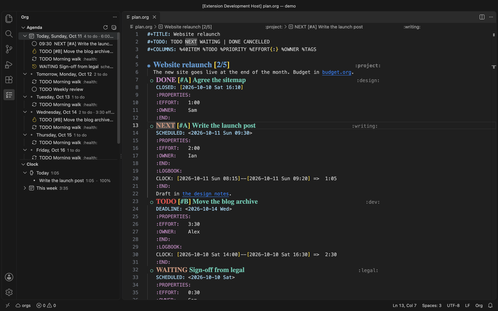

## What works on its own, and what needs orgs

| On its own | With the orgs server |
|------------|----------------------|
| The outline: folding, moving, promoting, sorting, narrowing | The agenda in the side bar: today and the week, with actions |
| TODO keywords, priorities, tags, statistics cookies | Clocking in and out, the Clock view, the focus timer |
| Tables: aligning, editing, sorting, plotting | Table formulas (`#+TBLFM:`) |
| Links and backlinks, footnotes, completion | Quick capture through the server's templates |
| Checkboxes, timestamps, the column view | Refile, archive and copy subtrees between files |
| Decorations: bullets, hidden link markup, source block shading | Running source blocks, `#+CALL:`, dynamic blocks, tangling |
| | Exporting to HTML, PDF, LaTeX, Markdown and Reveal.js / Impress.js slides |
| | Habits, encryption, attachments, file history, new files from templates, search across files |

## Features

### The outline

`Shift+Tab` cycles the whole file between overview, contents and everything;
`Tab` opens and closes one heading. `Alt+Up` / `Alt+Down` move a heading with
everything under it, and `Alt+Shift+Left` / `Alt+Shift+Right` promote and
demote it.

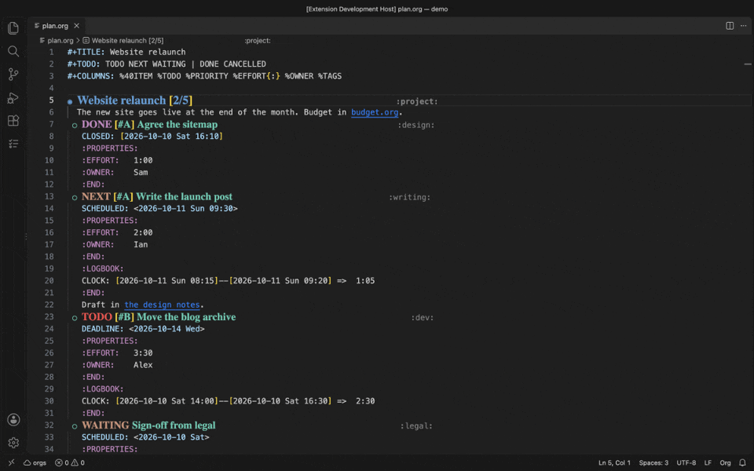

### TODOs and statistics cookies

`Alt+Left` / `Alt+Right` cycle a heading's keyword through the file's own
`#+TODO:` line, and the parent's `[2/5]` cookie keeps count.

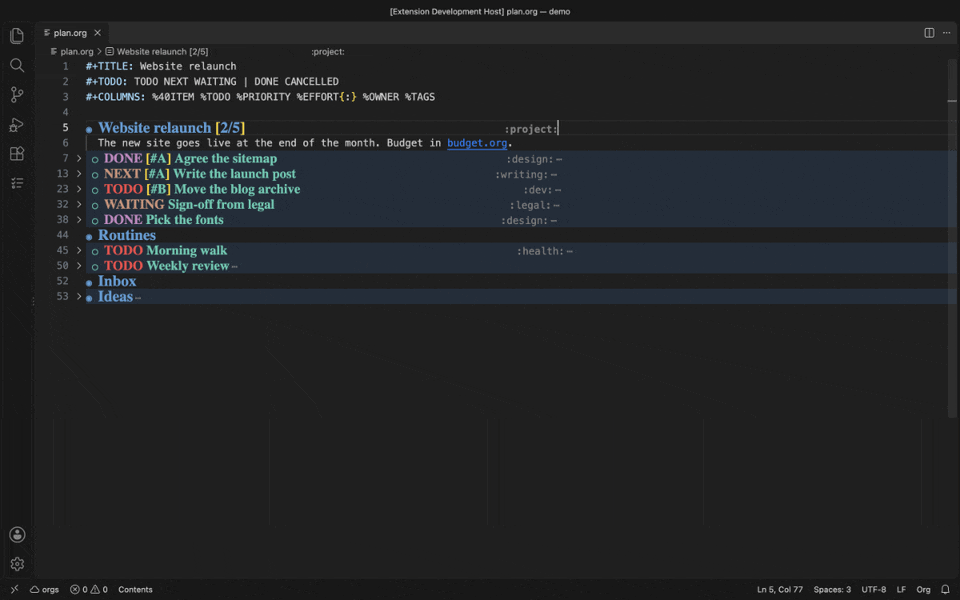

Checkbox lists keep their own cookie too.

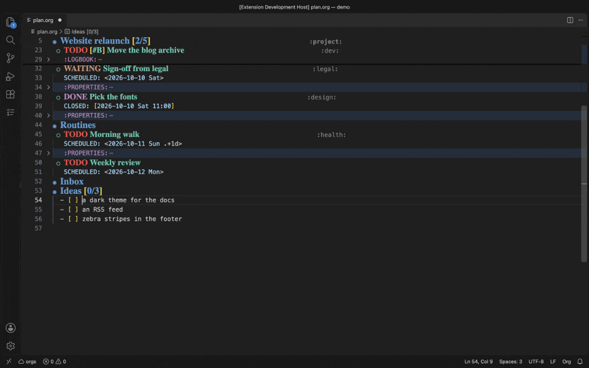

### Tables

Type a row roughly and `Tab` aligns the table and moves to the next cell.
Formulas in `#+TBLFM:` are worked out by the orgs server, from the text in the
editor, as one undo.

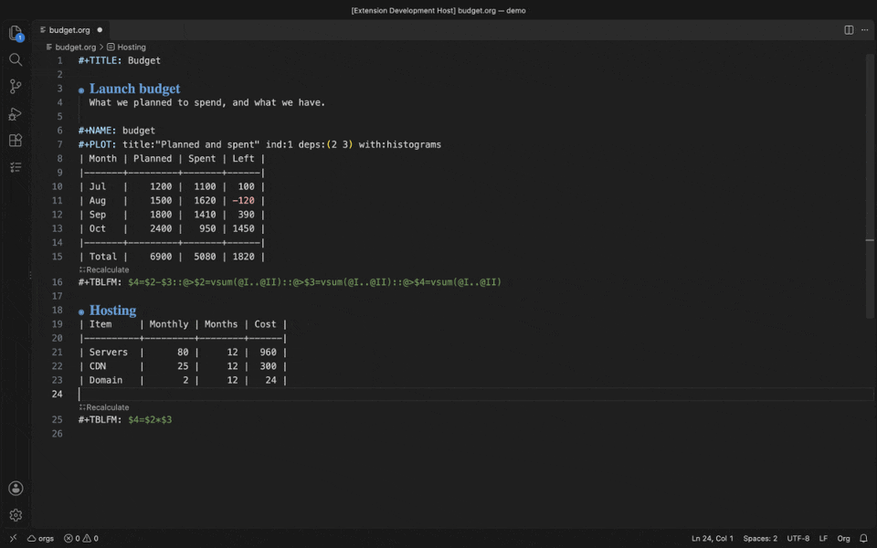

Hover a formula or a cell to see what it refers to, and plot a table with
`Ctrl+Alt+O G`.


### Dates and timestamps

`Ctrl+Alt+O .` inserts a timestamp: today, now, inactive ones, or a date from
the calendar, and it can also schedule or set a deadline on a heading.
`Alt+Left` / `Alt+Right` on a date move it a day at a time.

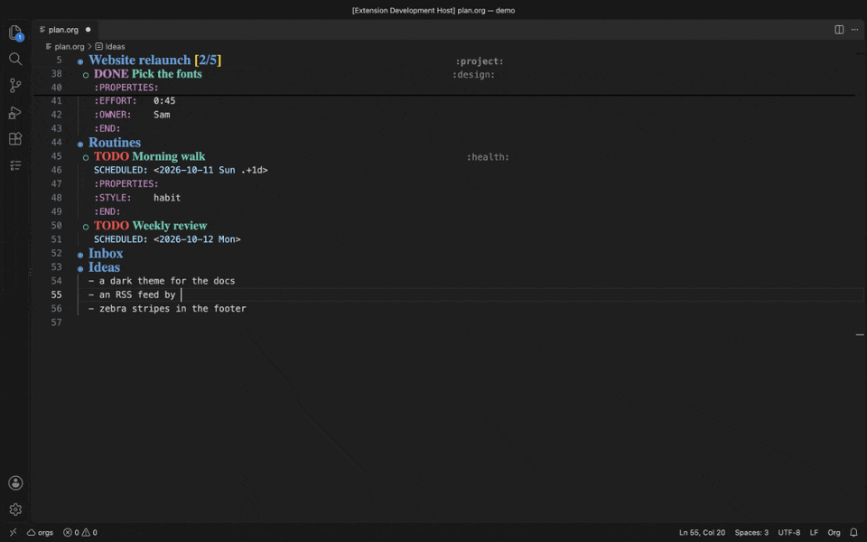

### The agenda and the clock (orgs)

The Org side bar shows today and the week from every org file the server
reads, and the Clock view shows what you clocked today and this week.
`Ctrl+Alt+O Ctrl+I` clocks in on the heading under the cursor, the status bar
shows the running clock, and `Ctrl+Alt+O Ctrl+O` clocks out, writing the
`CLOCK:` line into the logbook.

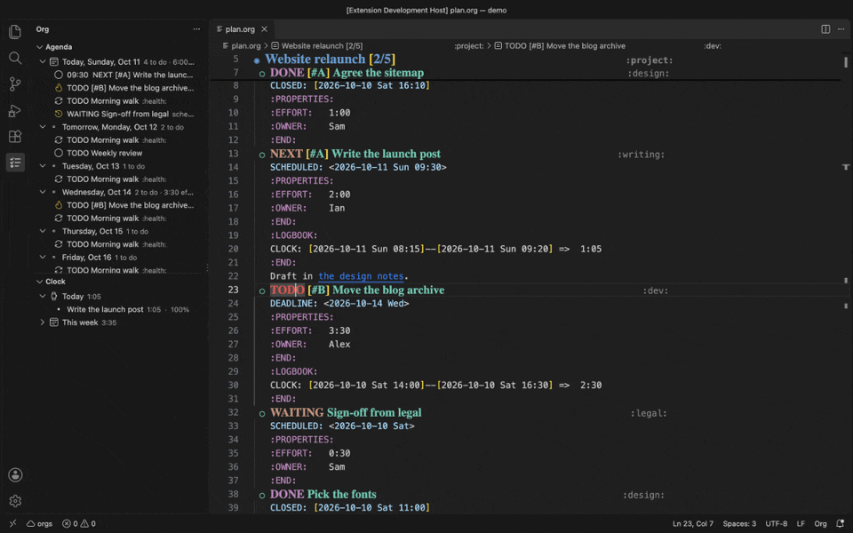

### Capture (orgs)

`Ctrl+Alt+O Q` captures a thought from anywhere in VS Code: pick one of the
server's capture templates, type a line, and the server files it.

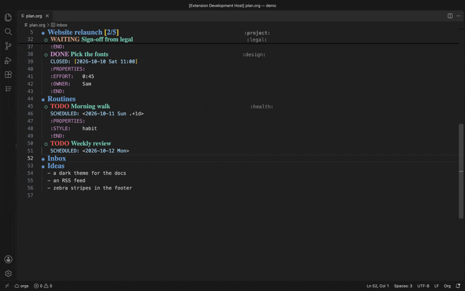

### Refile and archive (orgs)

`Ctrl+Alt+O W` refiles the subtree under the cursor to any heading in any org
file; archiving and copying work the same way.

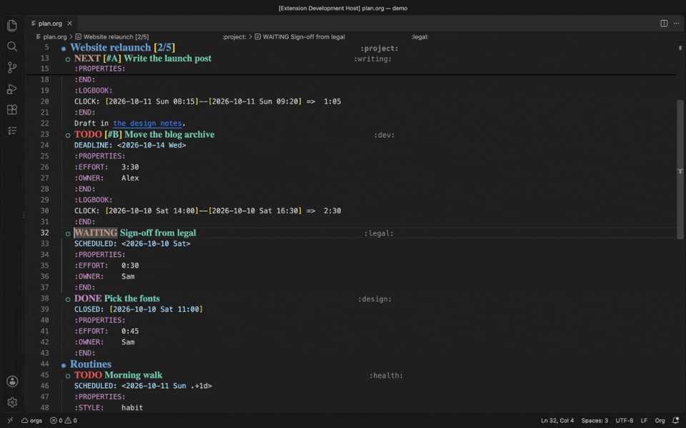

### Links

`Ctrl+Alt+O K` inserts a link to a web address, a file, or any heading the
server knows of. `F12` (or Ctrl+click) follows a link, and `Shift+F12` finds
everything that links to the heading you're on. Image links show a preview on
hover.

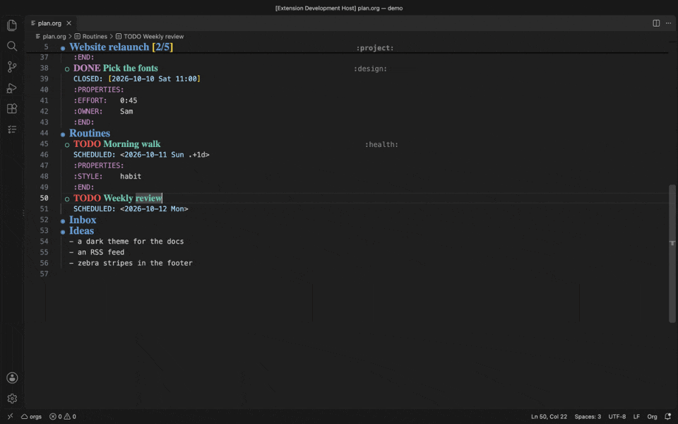

### Running code (orgs)

`Ctrl+Alt+O R` runs the source block under the cursor on the orgs server and
puts its `#+RESULTS:` under it. `#+CALL:` lines, dynamic blocks and tangling
are handled the same way.

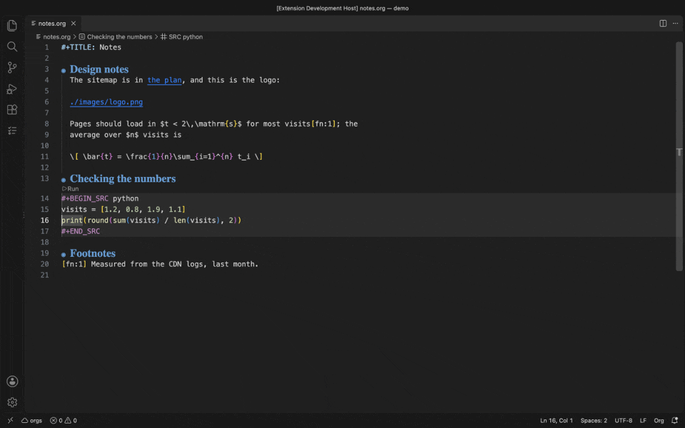

### Column view, previews and the menu

The column view shows headings and their properties as an editable table, with
totals:


Preview a file as a web page or slides, as a Gantt chart or a mind map, or see
its pictures and maths in a side panel:

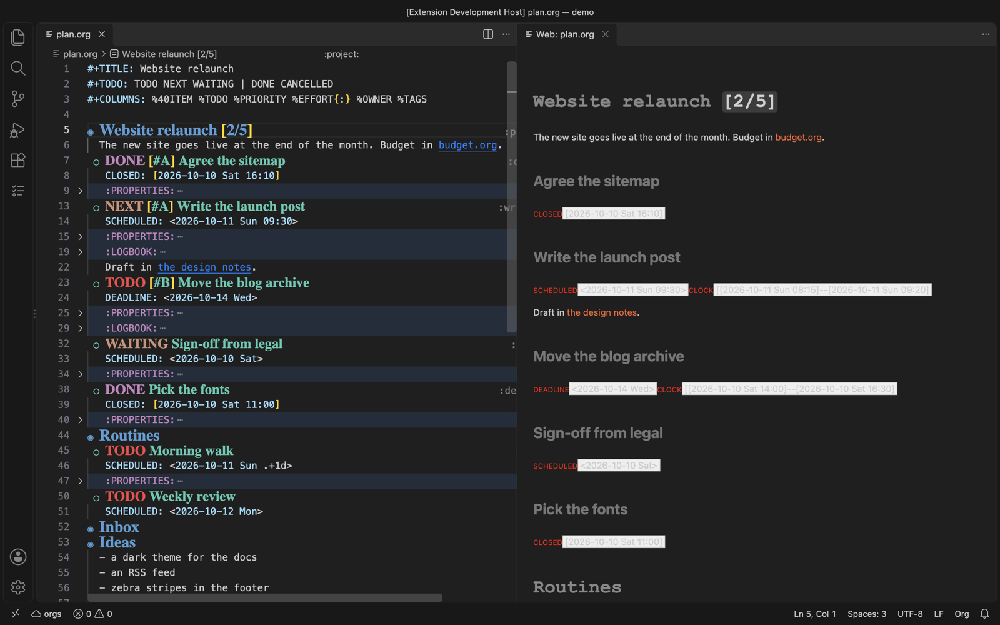

And when you don't remember a key, `Ctrl+Alt+O M` opens a menu of every org
command. The ones that fit where the cursor is come first, each shown with
its key:

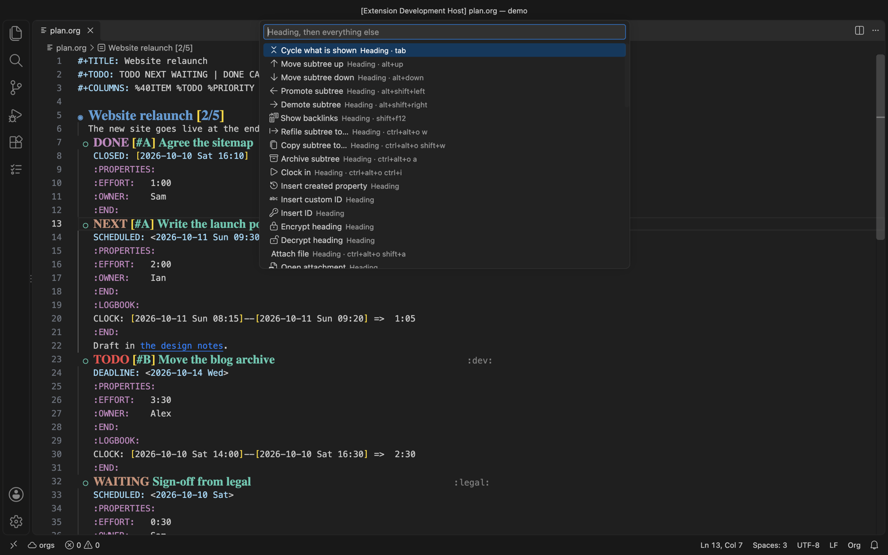

## Getting started

1. Install the extension from a `.vsix`: in the Extensions view, open the `...`
   menu and choose *Install from VSIX...*. To build one yourself, run
   `npm install && npx vsce package`. Open any `.org` file and the extension
   starts.
2. Run **Org: Open A Practice File**, or the walkthrough (*Help > Get Started*,
   then *Get started with Org Everywhere*).
3. To use the orgs features, start an [orgs](https://github.com/ihdavids/orgs)
   server (`orgs serve` in the directory with its `orgs.yaml`) and set
   **Org: Orgs Connection** (`org.orgsConnection`) to its address, for
   example `http://localhost:8010`. A server that wants a login asks once. A
   server started with `noAuth: true` doesn't ask at all.

The status bar shows the connection (`☁ orgs`). Click it to log in or out,
check the connection again, or change the address.

## The manual

The full manual is in [docs/guide](docs/guide/overview.org) and is built into
a single searchable page, [docs/iorg.html](docs/iorg.html). Good places to
start are [Getting started](docs/guide/getting-started.org) and
[Keys](docs/guide/keys.org).

| Page | Covers |
|------|--------|
| [Keys](docs/guide/keys.org) | Every key, including the VSCodeVim ones |
| [The outline](docs/guide/outline.org) | Tab cycling, moving, sorting, narrowing, statistics cookies |
| [Links](docs/guide/links.org) | Following (F12), backlinks (Shift+F12), inserting, image previews |
| [Completion](docs/guide/completion.org) | Tags, keywords, properties, blocks and link targets |
| [Tables](docs/guide/tables.org) | Aligning, formulas, sorting, plotting |
| [Dates and properties](docs/guide/dates.org) | Timestamps, CREATED, CUSTOM_ID, ID |
| [Footnotes](docs/guide/footnotes.org) | Following, inserting, hover |
| [Column view](docs/guide/column-view.org) | Headings and properties as an editable table, with totals |
| [Previews and panels](docs/guide/previews.org) | Web and slide previews, Gantt, mind map, pictures and maths |
| [The agenda](docs/guide/agenda.org) | Today and the week in the side bar, with actions |
| [Capture](docs/guide/capture.org) | Quick capture and the capture templates |
| [Running code](docs/guide/running-code.org) | Source blocks, calls, dynamic blocks, tangling |
| [Refiling and archiving](docs/guide/refile-archive.org) | Moving subtrees between files |
| [Clocking](docs/guide/clocking.org) | The clock, the Clock view, the focus timer |
| [Exporting](docs/guide/export.org) | HTML, PDF, LaTeX, Markdown and slides, of a file or a subtree |
| [The server's tools](docs/guide/orgs-tools.org) | Habits, encryption, attachments, history, new files, search |

## Building

```bash
npm install
npm run bundle         # esbuild: one minified-in-production file, dist/extension.js
npm run compile        # tsc type-check, and the tests into out/
npm test               # unit tests, then the extension tests in a VS Code
npx vsce package       # vscode-org-everywhere-<version>.vsix
```

The extension is bundled with esbuild, so the `.vsix` carries one JavaScript
file and no `node_modules`. The GIFs above are recorded from the demo files in
`tools/docs/demo` with `tools/docs/build.sh --clips` (it needs the orgs
repository beside this one, plus ffmpeg and gifski).

## Contributing

- Commands are `org.camelCase` and titled `Org: Title Case Words`; every key
  uses the `Ctrl+Alt+O` prefix.
- Filenames are kebab-case, e.g. `header-functions.ts`.
- `develop` is the integration branch (pull requests go there); `main` is the
  release branch.

## Gratitude

Org Everywhere began as a fork of
[vscode-org-mode](https://github.com/vscode-org-mode/vscode-org-mode), and we're
grateful to its authors and contributors. The original Org mode was written for
Emacs by Carsten Dominik, with the help and support of
[an impressive list of geniuses](https://orgmode.org/org.html#History-and-Acknowledgments).
This work is inspired by their masterpiece but isn't associated with it.

## License

[GNU General Public License v3](https://www.gnu.org/licenses/gpl-3.0.en.html) or
later, as the original. See [LICENSE.txt](LICENSE.txt).
